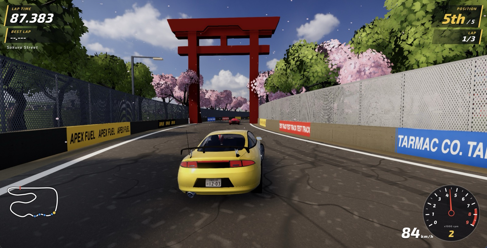
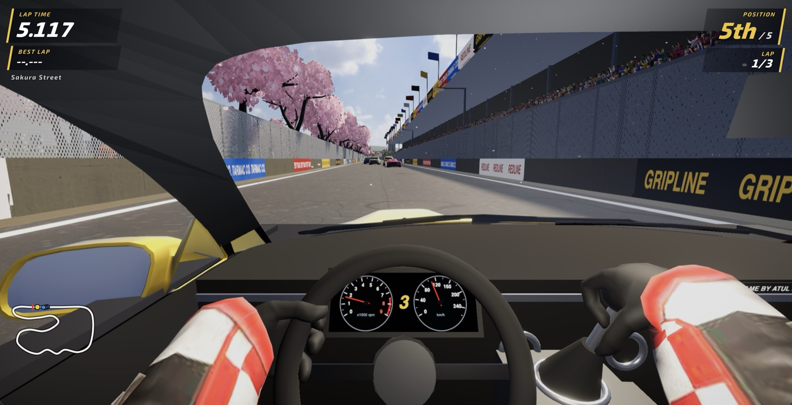

# Test Track

A daily 3D time-trial racer in the browser. **Play it: https://test-track-1.vercel.app/**



Built with Next.js 16, React 19, React Three Fiber and TypeScript. Works on desktop and phones.

## Why it's interesting
- **Deterministic physics:** the same inputs always give the exact same lap time, in the browser or in Node.
- **No float drift:** custom trig (`trig.ts`) instead of `Math.sin/cos`, so every JS engine agrees.
- **Rendering split from rules:** `src/sim/` is pure TypeScript; `src/game/` only draws it in 3D.
- **Golden tests:** any change that alters a lap time fails until it's versioned on purpose.

## Maps
Pick on the start screen, or use `?map=sakura` / `?map=circuit`.
- **Sakura Street** (default): a fixed 1.9 km Japanese street circuit with walls at the kerb, cherry blossom, an old
  town, a tunnel and a canal.
- **Grand Circuit**: an open race circuit with gravel run-off and grandstands, a new layout each day (`?seed=...`
  picks one).



**Controls:** arrows / WASD, R restart, C cycle camera, M mute. Touch buttons on phones.

## Run it locally
```sh
pnpm install
pnpm dev                 # http://localhost:3000
pnpm test                # determinism, golden, purity and lap tests
pnpm replay run.json     # headless replay; prints lap ticks, exits 1 on mismatch
pnpm tsx scripts/make-fixture.ts [seed] [out]   # autopilot lap -> run.json
```

## How it's built
- `src/sim/`: pure 60 ticks/s simulation, including the 4 AI cars, collisions and lap gates.
- `src/game/`: React Three Fiber renderer, audio and the browser tick loop.
- `test/sim.test.ts`: determinism, purity and golden lap tests.

## Credits
3D models and textures are free for commercial use and credited in [CREDITS.md](CREDITS.md).
